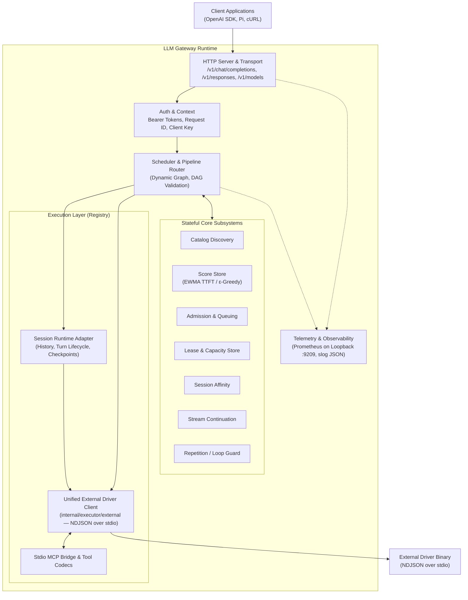
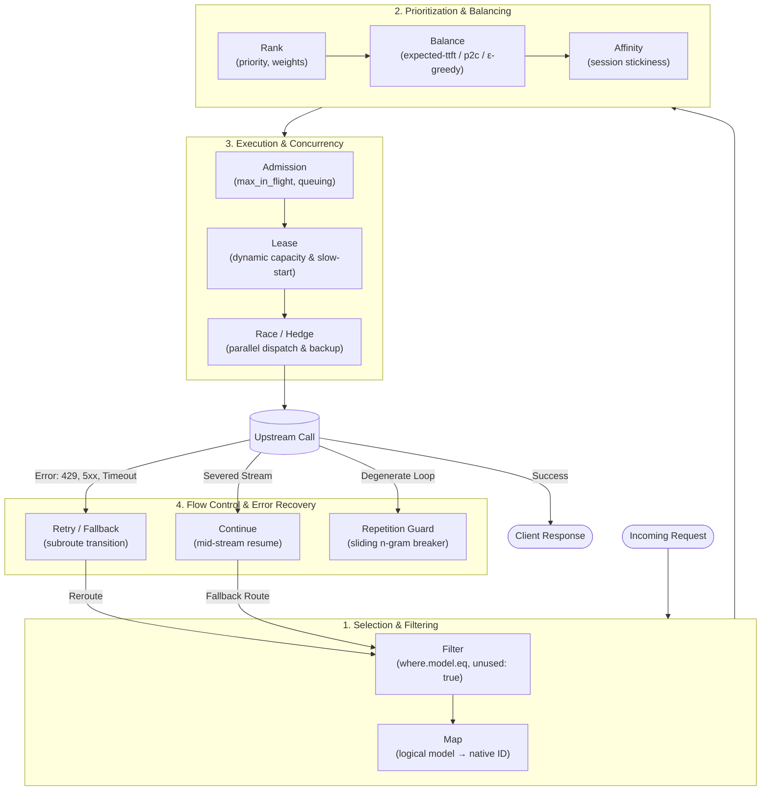
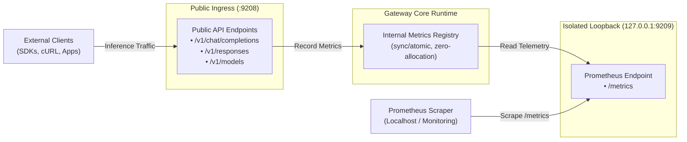

# LLM Gateway Architecture

This document describes the architectural design, internal components, routing pipeline, and resilience mechanisms of **LLM Gateway**.

---

## 1. Architectural Overview & Design Goals

LLM Gateway is a high-performance, OpenAI-compatible proxy and orchestration runtime written in Go. It mediates between client applications (OpenAI SDKs, cURL, agentic CLI harnesses like Pi) and heterogeneous AI backends (commercial HTTP APIs, native ACP agent processes, and browser automation drivers).



### Animated driver overview



### Core Design Tenets

1. **Virtual Logical Models**: Clients interact with abstract models (`standard`, `fast`, `reasoning`). Internal model IDs, upstream endpoints, credentials, and topology are completely hidden.
2. **Unified Execution Runtime**: Standard REST APIs, native subprocess ACP agents, and headless browser drivers share the same OpenAI Chat Completions interface and tool-calling semantics.
3. **Declarative Composable Pipeline**: Routing is defined via structured stages (`filter`, `map`, `rank`, `admission`, `balance`, `affinity`, `race`, `retry`, `hedge`, `timeout`, `fallback`, `continue`, `repetition`).
4. **Resilience by Default**: First-class support for parallel racing, hedging, automatic health cooldowns (circuit breakers), mid-stream break recovery, and degenerative loop guards.
5. **Zero-Trust Security & Operational Isolation**: Bearer tokens verified via constant-time comparisons, secrets support environment references, with `--require-env-secrets` enforcing them during configuration checks, and telemetry exposed on an isolated loopback port.

---

## 2. Codebase Organization

The codebase follows standard Go project conventions:

```text
llm-gateway/
├── cmd/
│   └── llm-gateway/            # Application entrypoint (CLI bootstrap)
├── configs/                    # Example JSON deployment and session configurations
├── docs/                       # Subsystem-specific deep-dives (e.g. session-executors.md)
├── drivers/                    # Isolated external provider driver binaries (NDJSON over stdio)
│   ├── http/                   # Standalone Go module (http-driver: Bifrost HTTP upstream adapter)
│   ├── acp/                    # Standalone Go module (acp-driver: agentrun ACP adapter)
│   └── web/                    # Standalone Rust crate (web-driver: CDP browser automation)
├── internal/
│   ├── executor/               # Executor registry, interfaces, and NDJSON driver clients
│   │   ├── session/            # Stateful session adaptation to OpenAI protocol
│   │   └── external/           # Unified NDJSON driver engine (HTTP multiplexed & stateful session)
│   ├── gateway/                # Daemon lifecycle, CLI commands (check, serve), signals
│   ├── model/                  # Domain types, capabilities, error taxonomy, token usage
│   ├── config/                 # Application JSON, secrets, defaults & startup configuration
│   ├── provider/               # Provider schema, driver discovery & preparation
│   ├── policy/                 # Routing DSL, compiled routes & graph validation
│   ├── scheduler/              # Execution engine, branch orchestration, streaming state machine
│   ├── server/                 # HTTP mux, authentication, SSE serialization, route handlers
│   ├── session/                # Conversation state manager, history hashing, tool turns
│   ├── subsystem/              # Independent stateful subsystems (Catalog, Admission, Scores, etc.)
│   └── telemetry/              # Zero-allocation Prometheus metrics and structured slog
```

The dependency-free [driver protocol contract](driverproto/README.md) is shared
by the Go drivers and gateway. Rust validates the same session fixtures.

Application configuration belongs to `internal/config`: it decodes JSON, resolves
secrets, normalizes listener and storage settings, and assembles the startup
configuration. `internal/provider` prepares drivers and their capabilities.
Startup explicitly runs decode/secret resolution → `PrepareConfig(ctx, cfg)`
(normalization and discovery, returning an opaque `PreparedConfig`) →
`CompileConfig(prepared)` (no processes or network) → executor startup.
The compiler cannot accept an unprepared public configuration. Prepared driver descriptions are passed into the
registry; startup never repeats capability discovery or consults a global cache.
Known legacy spellings are normalized at the JSON boundary; typed rules carry
only canonical fields. The provider envelope is strict: unknown options must be
inside the opaque driver `config`, and conflicting top-level/nested legacy
settings are rejected. Retry and fallback share the scheduler’s bounded transition
engine, including applicability filters, backoff and replay-safety guards.
`internal/policy` owns the routing DSL and compiles rules against prepared
providers; it does not depend on the application config or load credentials.
`CompiledConfig.RoutingPlan()` supplies the scheduler only with compiled models,
provider concurrency/cooldown settings and stream idle timeout. Gateway startup
owns store construction and persistence paths. Shared test builders and executor
fakes live under `internal/testsupport`, outside the production dependency graph.

`internal/scheduler/stream_run.go` owns the full client-stream lifetime:
selection, idle detection, repetition checks, continuation, bounded recovery,
usage and request observations, and admission release. Its synchronous
`StreamSink` interface reports output and transport keep-alives without depending
on HTTP. `internal/server/stream.go` implements that interface for SSE, including
headers, payload sanitization, keep-alive encoding and terminal error frames.
Transport exit cancels selection and releases the selected provider's capacity.
The route deadline bounds selection and recovery dispatch, including continuation
and held-stream recovery; a live selected stream may continue after that deadline
and remains bounded by its idle timeout.

---

## 3. Core Subsystems

The gateway delegates stateful operations to independent, thread-safe subsystems:

| Subsystem | Package | Responsibility |
| --- | --- | --- |
| **Catalog** | `internal/subsystem/catalog.go` | Refreshes native models and metadata through driver `models` commands. Maintains one last-known-good snapshot per provider for validation, metadata and session resolution. |
| **Score Store** | `internal/subsystem/score_store.go` | Tracks EWMA TTFT and health using at most 601 time buckets per provider. Retention covers the longest compiled balance window; reads of shorter windows never discard shared evidence. Buckets use one-second resolution by default and scale for longer windows. Implements $\epsilon$-greedy exploration across candidates. |
| **Provider Capacity** | `internal/subsystem/capacity.go` | Owns global provider reservations. Idempotent permits update the live count and metrics together; balancing reads the same count. |
| **Admission** | `internal/subsystem/admission.go` | Enforces concurrency controls per route/target (`max_in_flight`, `max_pending`, `wait_timeout`) to prevent upstream starvation and bufferbloat. |
| **Lease Store** | `internal/subsystem/lease.go` | Manages target capacity leases with slow-start recovery to smoothly ramp up traffic after cold starts or outages. |
| **Affinity Store** | `internal/subsystem/affinity.go` | Pins multi-turn client sessions or OpenAI Responses API chains to the winning upstream provider. |
| **Continue** | `internal/subsystem/continue.go` | Coordinates mid-stream break continuation, patching already-streamed token deltas onto prompt history for seamless failover. |
| **Repetition** | `internal/subsystem/repetition.go` | Analyzes generation chunks through a sliding n-gram window to detect runaway loops (e.g. infinite repetitive tool calls or text loops). |

---

## 4. Declarative Routing Pipeline

Routing is modeled as a linear pipeline executed by the scheduler for each incoming request:



### Pipeline Stages

1. **Selection & Filtering (`filter`, `map`)**:
   - Matches the requested logical model (`where.model.eq`).
   - Filters candidate providers (`where.provider.in`), excluding cooling or already-exhausted providers (`unused: true`).
   - Maps the logical model name to the native provider model (e.g., `standard` $\to$ `gpt-4o` on OpenAI, `claude-3-5-sonnet` on Anthropic).
2. **Prioritization & Load Balancing (`rank`, `balance`, `affinity`)**:
   - **`rank`**: Statically orders candidate targets by assigned priority or configured weight.
   - **`balance`**: Selects targets using real-time EWMA TTFT predictions (`expected-ttft`) with $\epsilon$-greedy exploration, or power-of-two-choices (`p2c`).
   - **`affinity`**: Enforces provider stickiness based on session IDs or Responses API context.
3. **Execution & Concurrency (`admission`, `lease`, `race`, `hedge`, `timeout`)**:
   - **`admission` & `lease`**: Guards upstream providers against saturation via queuing and bounded in-flight requests.
   - **`race`**: Dispatches $N$ parallel requests to the top-ranked providers; the first meaningful byte or completion wins, while losing branches are immediately cancelled.
   - **`hedge`**: Spawns an auxiliary backup request if the primary branch has not returned a first token within the configured duration.
   - **`timeout`**: Bounds admission, provider selection and recovery transitions with one deadline; an already selected live stream follows its separately configured idle timeout.
4. **Error Recovery & Flow Control (`retry`, `fallback`, `continue`, `repetition`)**:
   - **`retry` & `fallback`**: On error (429, 5xx, network timeout), transitions execution to dedicated subroutes with exponential backoff.
   - **`continue`**: Recovers from mid-stream connection drops by feeding already delivered text back into a fallback target.
   - **`repetition`**: Detects degenerate repetitive output patterns and safely trips the circuit breaker before tokens and budget are wasted.

---

## 5. Stateful Session Executors & Agent Tool Turns

Beyond standard stateless HTTP inference, LLM Gateway incorporates a session runtime that executes agentic workflows natively.

Driver-specific architecture and request flows live alongside each driver:

| Driver | Architecture and sequence diagrams |
| --- | --- |
| HTTP | [Multiplexed HTTP requests and upstream streaming](drivers/http/README.md#architecture-and-request-flow) |
| ACP | [ACP sessions and client tool calls through MCP](drivers/acp/README.md#architecture-and-tool-turns) |
| Web | [CDP browser sessions and prompt-based client tool calls](drivers/web/README.md#architecture-and-tool-turns) |

The session runtime shares history validation, pending tool turns, and checkpointing
across stateful drivers. Tool transport is selected per driver; the MCP flow applies
to ACP, while the Web example uses prompt-based tool envelopes. Custom drivers use
the shared [session NDJSON protocol](docs/session-executors.md#session-ndjson-driver-protocol).

### Key Components

- **`internal/session/runtime.go`**:
  - Maintains conversation threads identified by `X-Session-Affinity` or `session_id`.
  - Computes canonical history hashes to compute deltas: only new messages are delivered to existing native sessions.
  - Manages turn lifecycle, idle eviction (`session.ttl`), and turn timeouts (`session.turn_timeout`).
  - Implements atomic checkpointing (`session_file`) to persist resume IDs and session metadata across restarts.
- **`internal/executor/external`**:
  - Unified, driver-agnostic NDJSON-over-stdio client (`external.Driver` and `external.Describe`) serving both stateless multiplexed drivers (`stateful: false`, such as `http-driver`) and stateful session drivers (`stateful: true`, such as `acp-driver`, `web-driver`, or custom drivers).
  - Resolves `<driver>-driver` binaries dynamically via `ResolveDriverBinary` (or runs an explicit `command`), delegates driver-specific config validation and `Capabilities` discovery via the `{"type":"init",...}` handshake, and wraps stateful drivers in `sessionexecutor.New(...)`.
  - Pluggable tool strategies (`tool_strategy`) for stateful session drivers:
    - `mcp`: Delivers client tool schemas and results over the driver protocol; the ACP driver owns the private, session-scoped stdio MCP server.
    - `prompt`: Injects tool schemas into the system prompt and parses JSON responses (`DecodeToolResponse`) for text-only models.
    - `wire`: Uses direct line protocol events (`tool_call`, `tool_result`).
    - `both` / `auto`: Accepts both wire events and text prompt JSON (`acp` defaults `auto` to `mcp`).
- **External Driver Binaries (`drivers/`)**:
  - [`drivers/http/README.md`](drivers/http/README.md) (`http-driver`): Standalone Go module wrapping Bifrost Core for stateless HTTP/API providers.
  - [`drivers/acp/README.md`](drivers/acp/README.md) (`acp-driver`): Standalone Go module wrapping `agentrun` ACP agents.
  - [`drivers/web/README.md`](drivers/web/README.md) (`web-driver`): Standalone Rust crate automating browser sessions over CDP using YAML site profiles.
- **`drivers/acp/bridge.go` and `drivers/acp/facade.go`**:
  - Provide the private stdio MCP subprocess mode and the session HTTP facade inside the ACP driver.

---

## 6. Resilience & Stream Management

### Mid-Stream Break Continuation

When an upstream provider drops a connection mid-stream:
1. The gateway's stream reader detects the unexpected EOF or network error.
2. The tokens already flushed to the client are retained in memory.
3. If a `continue` rule is active, the scheduler activates the fallback route.
   `continue.max_buffer_bytes` bounds the retained output used for recovery
   (default 16 MiB). Exceeding the limit disables recovery for that response;
   normal delivery of the current stream continues.
4. The delivered partial output is appended as an assistant prefix in the continuation prompt.
5. The fallback provider seamlessly completes the generation from where the broken stream terminated.

### Repetition / Loop Guard

Degenerate models or recursive tool-call traps can trigger infinite output loops:
- The `repetition` subsystem tracks sliding token and n-gram windows.
- When an identical sequence repeats past the configured threshold, the stream is aborted.
- This prevents infinite token billing and client hang-ups.

### Circuit Breaking & Automatic Cooldown

- Providers returning retryable errors (429 Rate Limit, 502/503/504 Bad Gateway, transport resets) are put into automatic cooldown.
- While cooling, the provider is excluded from dynamic candidate pools.
- If all providers in a tier are cooling, the scheduler activates fail-open logic to prevent total denial of service.

---

## 7. Observability & Security Architecture

### Dedicated Loopback Metrics Architecture

Prometheus metrics are served over a physically separate HTTP listener:
- **Listener (`127.0.0.1:9209` by default)**: Configuration accepts numeric loopback addresses only, including `::1`.
- **Security Boundary**: The public API port (`:9208`) does **not** expose internal metrics. Scrapes cannot access client inference endpoints, and external clients cannot scrape internal operational telemetry.



### Key Prometheus Metrics

- `llm_requests_total`: Counter partitioned by status, route, logical model, provider, and client key.
- `llm_request_duration_seconds`: Histogram of end-to-end request duration.
- `llm_ttft_seconds`: Histogram of Time to First Token.
- `llm_input_tokens_total` / `llm_output_tokens_total`: Accurate token accounting.
- `llm_stream_breaks_total`: Counter for severed upstream streaming connections.
- `llm_requests_in_flight`: Real-time gauge of active upstream requests per provider.
- `llm_cooldown_until_seconds`: Gauge reflecting provider cooldown deadlines.

### Structured Logging (`log/slog`)

All log events are emitted to `stdout` in structured JSON:
- Every request is assigned a unique `request_id` propagated across all goroutines and upstream attempts.
- **Data Protection**: Prompts, system messages, tool inputs/outputs, and authentication credentials are strictly excluded from logs.
- Errors are sanitized through `telemetry.SafeLogDetail` to prevent unbounded log expansion and secret leakage.
