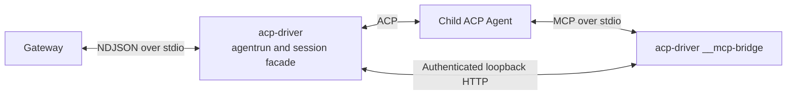
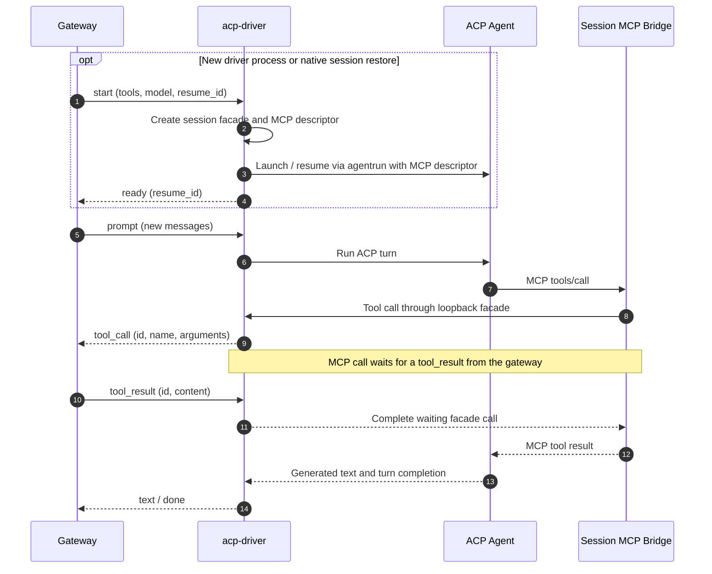

# ACP Agent Driver (`acp-driver`)

Standalone Go module implementing the stateful Agent Client Protocol (ACP) session driver for `llm-gateway`, powered by [`github.com/dmora/agentrun`](https://github.com/dmora/agentrun).

## Architecture and tool turns

Each active conversation owns an `acp-driver` process and its child ACP agent.
Both `tool_strategy: auto` and `mcp` expose tools supplied by the gateway
through the driver's session-scoped MCP bridge. The gateway exchanges NDJSON tool events with the driver.





The agent can also use its own built-in tools within the ACP turn. Session IDs
reported by the agent become `session_updated` events for gateway checkpointing.
See the [shared session lifecycle](../../docs/session-executors.md#lifecycle-and-routing)
for history validation, eviction, and missing-session policy.

## Source layout

```text
drivers/acp/
  go.mod            Standalone Go module (isolates agentrun and MCP SDK dependencies)
  main.go           NDJSON stdio loop for `models` discovery, `start`/`prompt` sessions, and `__mcp-driver` entrypoint
  engine.go         agentrun ACP process lifecycle, MCP bridge orchestration, model[effort] resolution
  bridge.go         Private stdio MCP subprocess mode (`__mcp-bridge`)
  facade.go         Session-scoped loopback HTTP facade translating MCP tool calls to NDJSON `tool_call`/`tool_result`
  engine_test.go    Unit and subprocess integration tests (models, effort, MCP bridge round-trip, effective model)
```

## Build and test

From the repository root:

```sh
# Build into bin/acp-driver (included in `make build`)
make build-acp

# Run standalone module tests with race detector
go test -race -C drivers/acp ./...
```

When `llm-gateway` resolves a provider with `"driver": "acp"`, [`external.ResolveDriverBinary`](../../internal/executor/external/resolve.go) locates `acp-driver` next to the gateway executable, in `./bin/acp-driver`, on `$PATH`, or builds `./drivers/acp` on demand in a source checkout, and passes the configured `command` inside the NDJSON `init`/`start`/`models` `config` payload.

## Gateway configuration

```json
{
  "id": "acp-codex",
  "driver": "acp",
  "tool_strategy": "mcp",
  "command": ["codex-acp"],
  "env": {
    "OPENAI_API_KEY": "env.OPENAI_API_KEY"
  },
  "session": {
    "default_cwd": ".",
    "allowed_roots": ["."],
    "ttl": "10m",
    "turn_timeout": "30m",
    "heartbeat": "20s"
  }
}
```

- `driver`: `"acp"`.
- `tool_strategy`: `"auto"` (default) or `"mcp"`. Both deliver client `tools` from the gateway `start` handshake to the ACP agent through `acp-driver`'s session-scoped stdio MCP bridge (`acp-driver __mcp-bridge`) and forward tool invocations over NDJSON `tool_call` / `tool_result` events.
- `command`: Executable and arguments of the target ACP agent binary (passed directly via `exec`, no shell interpretation).

## Behavior and ACP specifics

### Non-interactive HITL-off mode

`acp-driver` spawns the underlying ACP agent with `agentrun.WithHITL(agentrun.HITLOff)`. Publishing a client's (e.g., Pi's) tools through MCP does not disable the ACP agent's native built-in tools or its internal agent loop. When the client must exclusively own all tool execution, use an HTTP model or browser driver instead.

### Model discovery and bracketed `model[effort]` resolution

- Before starting a conversation, the gateway can query available models by sending `{"type":"models"}` to `acp-driver`.
- `acp-driver` probes the ACP agent with an initial session, reads `EventInit.AvailableModels`, and replies with `{"type":"models","models":[...]}`.
- Use native model `"default"` to leave model selection to the ACP agent.
- Concrete ACP models can expose reasoning effort variants using bracket syntax (e.g. `gpt-5[low]`, `gpt-5[high]`). When a request specifies a base model and `reasoning_effort`, the gateway and `acp-driver` resolve the corresponding `model[effort]` variant and verify that the ACP agent actually switches to the requested effective model. Single-target logical models advertise discovered reasoning efforts through `/v1/models`.

### Native session restore (`resume_id`)

- When `resume_id` is supplied in `{"type":"start"}`, `acp-driver` sets `agentrun.OptionResumeID`.
- If the ACP agent reports that the session does not exist (`session not found`, `unknown session`, `invalid session`, etc.), `acp-driver` emits `{"type":"session_not_found"}` so the gateway's session runtime can automatically replay the conversation history into a fresh native session.
- If the agent assigns or updates its session ID via `EventInit.SessionID`, `acp-driver` emits `{"type":"session_updated","resume_id":"..."}` before completing the turn.

### Process lifecycle

- Each active conversation session owns one `acp-driver` process and its child ACP agent process.
- When `stdin` closes (EOF) or the process receives `SIGINT`/`SIGTERM`, `acp-driver` cancels the active turn and terminates the child ACP agent process cleanly.

## NDJSON wire protocol

- **`init` / `describe`**: Validates `tool_strategy` (`"auto"` or `"mcp"`) and `config.command`, returning `{"type":"ready","tool_strategy":"mcp","capabilities":{"chat":true,"streaming":true,"tools":true,"stateful":true,"resume":true}}`.
- **`models` / `start` / `prompt`**: See the shared [Unified NDJSON Driver Protocol](../../docs/session-executors.md#session-ndjson-driver-protocol) for the full message reference (`init`, `start`, `prompt`, `models`, `ready`, `session_not_found`, `session_updated`, `text`, `reasoning`, `usage`, `done`, `error`).
