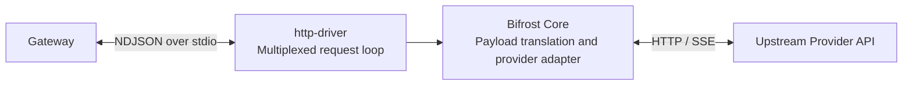
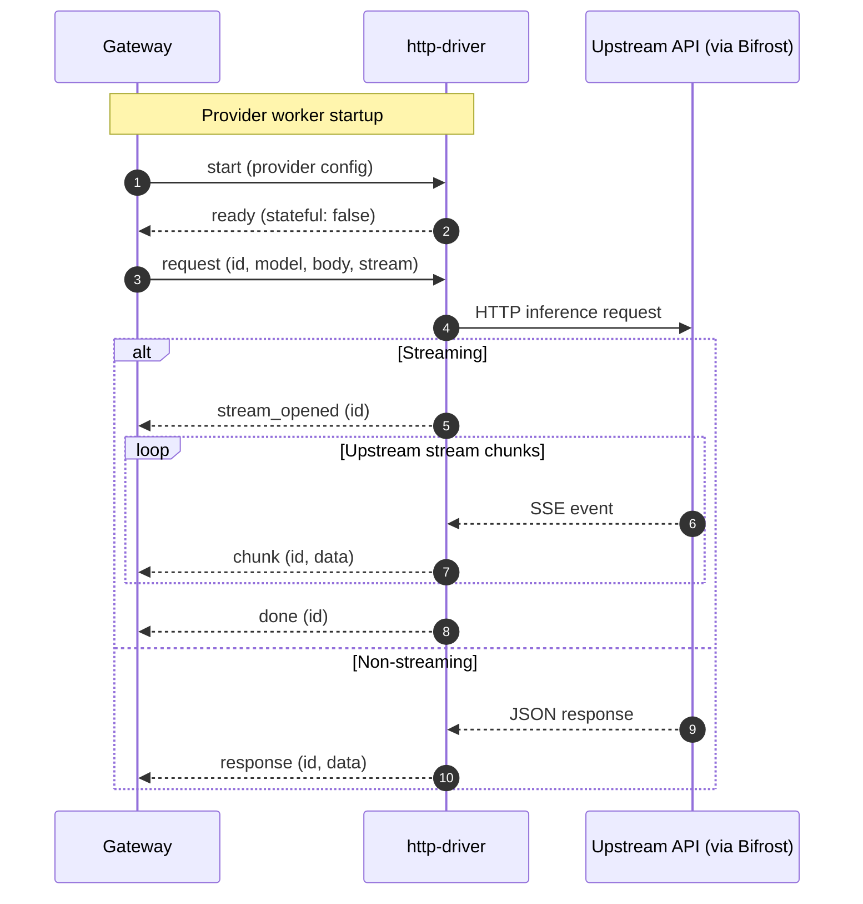

# HTTP Provider Driver (`http-driver`)

Standalone Go module implementing the stateless multiplexed NDJSON HTTP/API provider driver for `llm-gateway`, powered by [Bifrost Core](https://github.com/maximhq/bifrost).

## Architecture and request flow

One long-lived `http-driver` process serves each configured HTTP provider.
Concurrent requests share the stdio connection and are correlated by request `id`.





Tool calls are returned to the gateway as part of the upstream response.
Tool results arrive in the body of a subsequent gateway request. The driver keeps
no native conversation session. While a request is in flight, the gateway can send
`cancel (id)` to cancel its upstream context, leaving other request IDs running.

## Source layout

```text
drivers/http/
  go.mod              Standalone Go module (isolates Bifrost & provider SDK dependencies)
  main.go             Long-lived multiplexed NDJSON stdio loop (start, request, cancel)
  executor.go         Bifrost Core account adapter, request/response translation, error mapping
  executor_test.go    Unit tests for Bifrost payload translation, Vertex config, and error classes
```

## Build and test

From the repository root:

```sh
# Build into bin/http-driver (included in `make build`)
make build-http

# Run standalone module tests with race detector
go test -race -C drivers/http ./...
```

When `llm-gateway` resolves a provider with `"driver": "http"` (the default when `"driver"` is omitted), [`external.ResolveDriverBinary`](../../internal/executor/external/resolve.go) locates `http-driver` next to the gateway executable, in `./bin/http-driver`, on `$PATH`, or builds `./drivers/http` on demand in a source checkout.

## Gateway configuration

Providers default to `"driver": "http"` when `"driver"` is omitted:

```json
{
  "id": "openai-primary",
  "driver": "http",
  "base_provider": "openai",
  "inference_url": "https://api.openai.com/v1",
  "api_key": "env.OPENAI_API_KEY",
  "strip_params": ["service_tier"],
  "set_params": {
    "store": false
  }
}
```

### Supported `base_provider` options

- **OpenAI & OpenAI-compatible (`"openai"`):**
  - Custom `chat_completions_path` and `responses_path` overrides.
  - Automatic normalization of trailing `/v1` in `inference_url` when custom paths are configured.
- **Google Vertex AI (`"vertex"`):**
  - Supports Vertex OAuth bearer tokens (`api_key` or `vertex.auth_credentials`) as well as service-account JSON credentials.
  - Supports resource-scoped publisher model URLs (`projects/.../locations/.../publishers/.../models/...`) and custom `inference_url` routing via an internal round-tripper rewrite.
- **All other Bifrost providers (`"anthropic"`, `"bedrock"`, `"cohere"`, `"gemini"`, etc.):**
  - Configured via `base_provider`, `api_key`, `inference_url`, and `extra_headers`.

### Payload normalization & parameter rewriting

- **`strip_params` / `set_params`:** Applied to the outbound JSON payload via `sjson` before passing to Bifrost (`model` is protected from accidental overwrite).
- **Empty stream chunk filtering:** Blank initialization chunks (no content, reasoning, tool calls, `finish_reason`, or usage) are filtered out until a meaningful chunk arrives, so empty warm-up frames do not prematurely count as Time to First Token (TTFT).
- **Reasoning backfill:** When a non-streaming response includes `reasoning_details` array items without a top-level `reasoning_content` string, the driver backfills `reasoning_content` for client compatibility.

## Multiplexed NDJSON wire protocol

Unlike stateful session drivers (which run one process per conversation session), `http-driver` runs as a single long-lived subprocess per configured HTTP provider and multiplexes concurrent in-flight requests by `id` over `stdin`/`stdout`.

### Inbound commands (`stdin`)

1. **Initialization & capability check (`init` / `describe`):**
   ```json
   {"type":"init","id":"openai-primary","models_url":"","request_timeout_ms":60000,"config":{"base_provider":"openai","inference_url":"https://api.openai.com/v1","api_key":"..."}}
   ```
   Validates the provider configuration and replies with `ready`, reporting `capabilities` (`chat`, `responses`, `streaming`, `tools`, `safe_replay`, `stateful: false`), normalized `config`, and optional model discovery `catalog`.
2. **Start multiplexed worker (`start`):**
   ```json
   {"type":"start","id":"openai-primary","config":{...}}
   ```
   Replies with `{"type":"ready","capabilities":{...}}` once the Bifrost client and provider configuration are initialized.
3. **Execute request (`request`):**
   ```json
   {"type":"request","id":"req-1","provider":"openai-primary","model":"gpt-4o","kind":"chat","stream":true,"stream_idle_timeout_ms":300000,"body":{...}}
   ```
4. **Cancel in-flight request (`cancel`):**
   ```json
   {"type":"cancel","id":"req-1"}
   ```
   Cancels the context associated with request `id` immediately without affecting other concurrent requests on the same driver process.

### Outbound events (`stdout`)

| Type | Fields | Meaning |
| --- | --- | --- |
| `ready` | `capabilities`, `catalog`, `config` | `init` validation or `start` handshake succeeded |
| `response` | `id`, `data` | Non-streaming JSON response completed |
| `stream_opened` | `id` | Upstream streaming connection established |
| `chunk` | `id`, `data`, `event`, `meaningful` | Sanitized stream chunk |
| `done` | `id` | Stream finished cleanly |
| `error` | `id`, `error`, `call_error` | Config validation error or classified upstream `CallError` |
