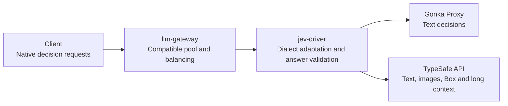

# JEV decision driver

`jev-driver` is an independent Go module implementing the stateless multiplexed
[NDJSON protocol](./../../driverproto/README.md) using the standard library. The
shared [System One contract](./../../docs/systemone.md) validates requests and
answers. No SDK, Bifrost adapter or hidden retry loop is involved.



Provider `driver` is `jev`. Its `config` requires:

- `dialect`: `gonka` or `typesafe`.
- `inference_url`: a versioned base URL, e.g. `https://api.typesafe.ai/v1` or
  `https://api.proxy.gonka.gg/v1`. The driver appends `/systemone`.
- `api_key`: the upstream bearer key, normally an `env.NAME` reference resolved
  by the gateway. Request bodies and credentials are never logged.

`init`/`describe` validate locally without network calls. `start` opens one worker
per provider; request IDs multiplex concurrent decisions, and `cancel` aborts only
the specified HTTP call. Every request makes at most one upstream inference call,
including when `single_attempt` is set. Redirects are disabled. Scheduler policies
own retry, balancing, cancellation of race losers, deadlines and provider capacity.

Capabilities include `systemone`, `safe_replay` and `single_attempt`; TypeSafe also
advertises `systemone_images`, `systemone_box`, `systemone_long_context`. No Chat,
Responses, streaming, tools or stateful capabilities are advertised. Model discovery
uses TypeSafe's `GET /models` response, or the known Gonka model `jev`.

```sh
make build-jev
go test -race -C drivers/jev ./...
```

The [configuration example](./../../configs/config.jev.json) uses both providers in
one balanced tier, with independent native model mappings and no fixed provider
preference. The [Gonka API reference](https://proxy.gonka.gg/docs/jev) documents the
eligibility rule and text dialect; the
[official API reference](https://docs.typesafe.ai/api/system-one) defines the public
contract used by the gateway.
